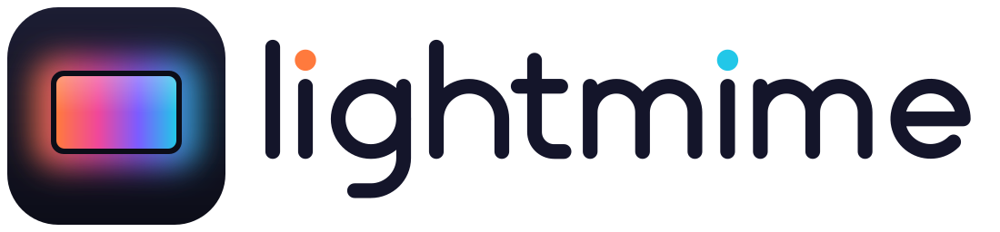

<p align="center">
  <picture>
    <source media="(prefers-color-scheme: dark)" srcset="assets/brand/lightmime-logo-dark.svg">
    
  </picture>
</p>

# lightmime

<p>
  <a href="https://lightmime.pataar.nl/docs/"></a>
  <a href="https://github.com/pataar/lightmime/actions/workflows/ci.yml"></a>
  <a href="https://github.com/pataar/lightmime/releases/latest"></a>
</p>

Sync Philips Hue lights with your screen on Linux.

lightmime watches what is on your screen and colours the lights of a Hue entertainment area to match it, the way Hue
Sync does on other systems. It streams over the bridge's Entertainment API, so the lights follow the picture with low
latency.


- **A small window and a tray icon**: pair with the bridge, pick an area, start syncing and tune brightness, smoothing
  and saturation while it runs. See [Window and tray](https://lightmime.pataar.nl/docs/gui.html).
- **Made for Wayland**: capture goes through the screen-cast portal and PipeWire, on KDE Plasma, GNOME and wlroots
  compositors. You pick the screen once.
- **Headless if you like**: `lightmime run` as a [systemd user service](https://lightmime.pataar.nl/docs/background.html).
- **Home Assistant, optionally**: turn on MQTT and lightmime appears as a device with a sync switch, a status sensor
  and sliders. See [Home Assistant](https://lightmime.pataar.nl/docs/home-assistant.html).
- **Light on resources**: one Rust binary that scales each frame down to 64×36 pixels before touching it. While syncing
  at 30 fps it uses about 1 % of one CPU core and 36 MB of memory
  ([measurement](https://lightmime.pataar.nl/docs/comparison.html#resource-use)).

## Install

```sh
flatpak remote-add --user --if-not-exists flathub https://dl.flathub.org/repo/flathub.flatpakrepo
flatpak remote-add --user --if-not-exists lightmime https://lightmime.pataar.nl/flatpak/lightmime.flatpakrepo
flatpak install --user lightmime io.github.pataar.lightmime
```

Release binaries and building from source are under [Install](https://lightmime.pataar.nl/docs/install.html). Then follow
the [Quickstart](https://lightmime.pataar.nl/docs/quickstart.html): pair, choose an area, press Start.

You need a Hue bridge with an entertainment area set up in the Hue app, and a desktop with PipeWire and an
`xdg-desktop-portal` backend that offers screen casting.

## From the command line

```sh
lightmime pair --host 192.168.1.20   # press the bridge's link button when asked
lightmime areas                      # list entertainment areas
lightmime use-area "TV area"         # pick one
lightmime test                       # 8-second colour sweep, no screen capture
lightmime run --start                # capture and sync until Ctrl-C
lightmime gui                        # the window and tray icon
```

See the [CLI reference](https://lightmime.pataar.nl/docs/cli.html) and [Configuration](https://lightmime.pataar.nl/docs/configuration.html).

## Desktop integration

The Flatpak brings its launcher entry and icons. For a binary or source install, add them for the launcher entry,
window icon and tray icon:

```sh
install -Dm644 contrib/io.github.pataar.lightmime.desktop ~/.local/share/applications/io.github.pataar.lightmime.desktop
cp -r assets/icons/hicolor ~/.local/share/icons/
```

## How it works

1. **Capture**: ScreenCast portal → PipeWire node → GStreamer
   (`pipewiresrc ! videoconvert ! videoscale`) → 64×36 RGB frames.
2. **Mapping**: each entertainment channel samples the screen region matching
   its position in the area (x = left/right, z = bottom/top), averaged in
   linear light, then saturation, smoothing and brightness are applied.
3. **Streaming**: the area is started through the CLIP v2 API, then HueStream
   v2 messages go out over DTLS 1.2 (PSK, `PSK-AES128-GCM-SHA256`) to UDP port
   2100, one datagram per frame.

More in [How it works](https://lightmime.pataar.nl/docs/how-it-works.html).

## Build your own frontend

The engine is a separate crate, [`lightmime-core`](crates/lightmime-core/README.md), with no user interface: capture,
colour mapping, pairing, area listing and streaming behind a small `Engine` handle. The bundled window, daemon and CLI
use nothing else, so a GTK, Qt or web frontend can do the same.
[`examples/minimal.rs`](crates/lightmime-core/examples/minimal.rs) pairs, picks an area and syncs in about 70 lines.

## Compared with Lumux and HyperHDR

| | lightmime | [Lumux](https://github.com/enginkirmaci/lumux) | [HyperHDR](https://github.com/awawa-dev/HyperHDR) |
|---|---|---|---|
| Written in | Rust | Python (GTK4 / libadwaita) | C++ |
| Lights | Philips Hue | Philips Hue | Hue, LIFX, WLED, LED strips over serial/SPI, and more |
| Screen capture on Wayland | Portal + PipeWire | Portal | Portal + PipeWire, also USB HDMI grabbers |
| Interface | Window, tray, CLI | Window, tray | Web interface |
| Runs headless | Yes, also as a systemd user service | No | Yes, but PipeWire capture needs it to run as a user app, not a system service |
| Home Assistant | MQTT discovery | No | MQTT |
| Platforms | Linux | Linux | Linux, Windows, macOS |

Pick HyperHDR if you drive LED strips, use an HDMI grabber or want HDR tone mapping; it does much more. lightmime does
one thing, Hue sync from a Linux desktop, with as little setup and overhead as possible. More in
[Compared with other tools](https://lightmime.pataar.nl/docs/comparison.html).

## Contributing

Bug reports and pull requests are welcome; see [CONTRIBUTING.md](CONTRIBUTING.md). [AGENTS.md](AGENTS.md) describes
the architecture, protocol notes and the Home Assistant contract. Logo, icons and colours are in
[`assets/brand/`](assets/brand/README.md).

## Licence

Licensed under either of [MIT](LICENSE-MIT) or [Apache-2.0](LICENSE-APACHE), at your option. lightmime is not
affiliated with Signify or Philips Hue.
